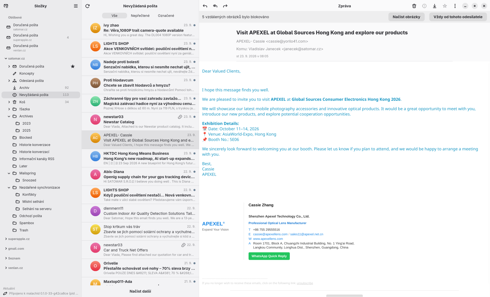
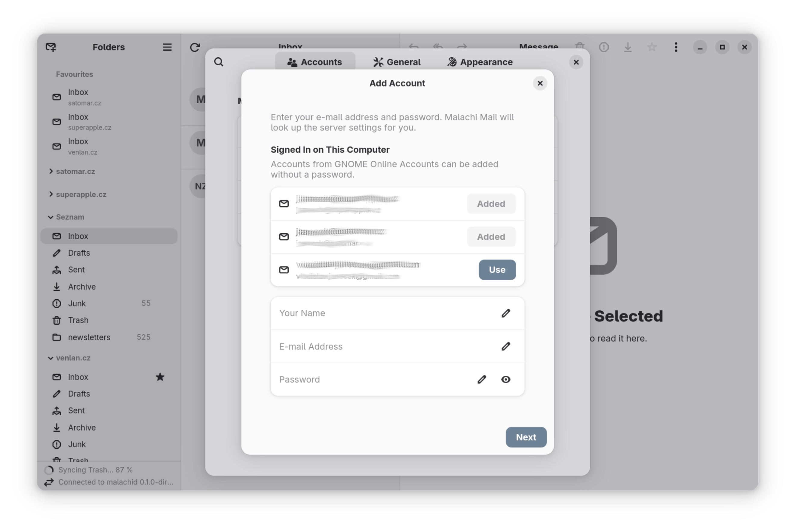
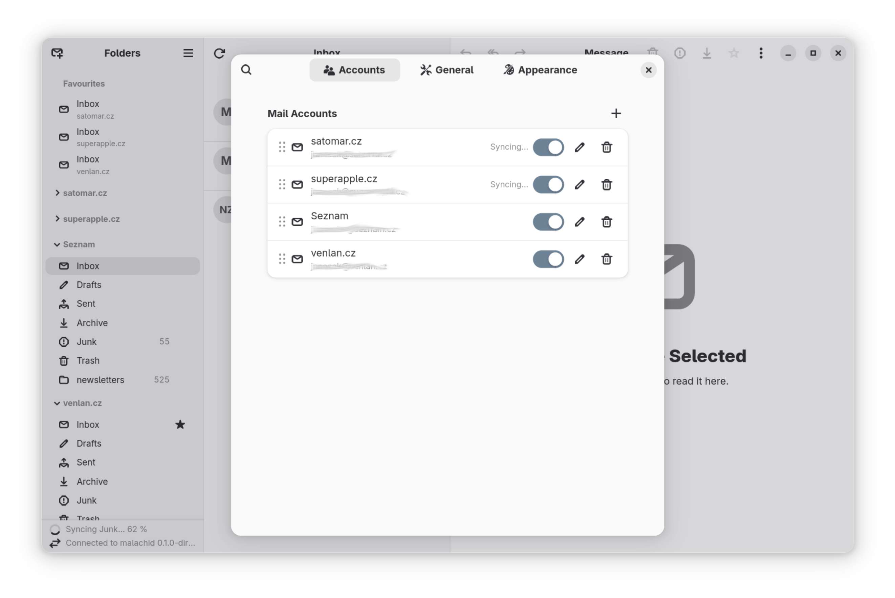
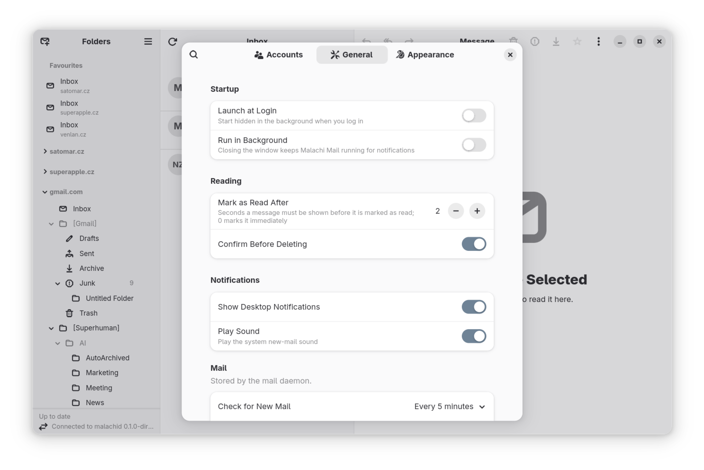
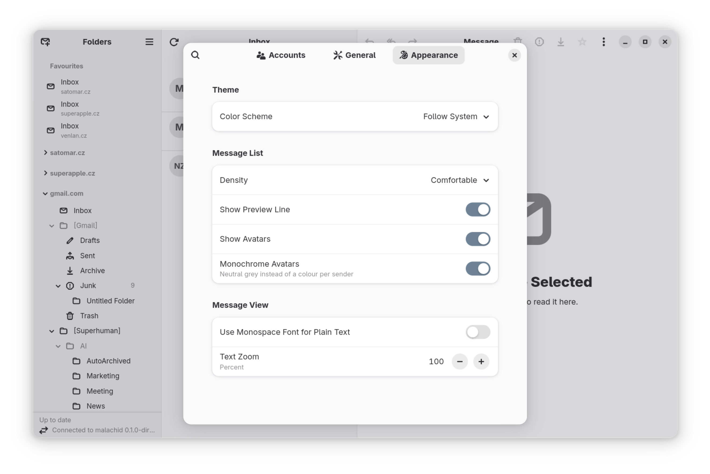

<p align="center">
  
</p>

<h1 align="center">Malachi Mail</h1>

<p align="center">A native email client: one Go core with all the logic, a native UI for each platform: Linux, macOS and Windows.</p>

Built because the existing options are either showing their age or do not
work reliably anymore. It started on Linux, where that is worse than
anywhere else; the same core now drives a native app on macOS and Windows
as well.

> **Project status: early, usable with care.** Version 0.1.2 runs on
> Linux, macOS and Windows 11. It reads, writes and sends mail over
> IMAP/SMTP, Microsoft 365 and Gmail, renders HTML after sanitising it,
> keeps mail available offline, groups it into conversations, searches
> it, follows Jira issues, keeps a calendar, sorts what waits for you on
> a board, and has an [MCP bridge](#ai-agents-mcp) for AI agents.
>
> It is young, and a bug in the sync engine can still touch messages on the
> server. Keep a second mail program for anything that matters.

## Screenshots

The GTK client on Linux, from before conversations, the calendar and the
board arrived; the macOS and Windows apps show the same panes with their
platform's widgets.

|  |  |
|---|---|
| [](docs/screenshots/Malachi01.png) | **The main window.** Folders of every account in one sidebar, favourites pinned on top, the message list with its All / Unread / Flagged filter, and the message itself. The bar above the body says the remote images were blocked and offers to load them once or to trust the sender from now on. |
| [](docs/screenshots/Malachi02.png) | **Adding an account.** On GNOME, accounts already signed in through GNOME Online Accounts are offered without a password; elsewhere Microsoft 365 signs in in the browser, and for anything else the assistant looks the server settings up from the address alone. |
| [](docs/screenshots/Malachi03.png) | **Accounts.** Every account can be reordered, paused, edited or removed, and shows what the synchronisation is doing right now. |
| [](docs/screenshots/Malachi04.png) | **General preferences.** Launch at login and running in the background, when a message counts as read, desktop notifications with the system new-mail sound, and how often the mail is fetched. |
| [](docs/screenshots/Malachi05.png) | **Appearance.** Light, dark or the system's choice; the density of the message list, its preview line and avatars; the font and zoom of the message view. |

## What works today

On all three platforms unless said otherwise:

- **Accounts.** IMAP/SMTP with a setup assistant that finds the server
  settings for most providers. Microsoft 365 / Outlook.com sign in in
  your browser out of the box; Gmail / Google Workspace with an app
  password or a Google client of your own
  ([OAuth clients](#oauth-clients-for-gmail-and-microsoft-365)); on GNOME
  both can also come from GNOME Online Accounts. Passwords and tokens
  live in the system keyring (Secret Service, the login keychain,
  Credential Manager). A server with a certificate of its own can be
  trusted explicitly, by its fingerprint.
- **Reading offline.** Folders and messages are synchronised into a local
  store within a configurable retention window; new mail arrives as the
  server announces it (IMAP IDLE). Flags, moves and deletions are queued
  locally and pushed back. To save disk space the stored mail can be kept
  compressed, and the large attachments of older messages can stay on the
  server until you open them. With *Never Store Attachments* none is
  stored but the pictures a message shows (drafts and signed or encrypted
  mail stay whole): an attachment you open is downloaded into memory and
  is gone when you quit.
- **HTML mail, safely.** Bodies are sanitised in the daemon before the UI
  sees them. Remote images stay blocked until you load them or trust the
  sender; the renderer runs with JavaScript off, a strict content policy
  and no network. Attached messages open read-only in their own window;
  other attachments open in a preview (GNOME Sushi, Quick Look, a viewer
  of the app's own on Windows).
- **Writing.** Formatted text, attachments and inline images; recipients
  as removable badges; plain text that looks like Markdown is pasted as
  formatted text. A message that cannot go out right away waits in a
  local Outbox and is retried; a copy is filed in Sent. Drafts rest in
  the account's Drafts folder, so another client sees them too.
  Recipients are completed from the people you have written to, and on
  GNOME from the system address books as well.
- **Conversations.** The daemon threads mail by its headers as it
  arrives; *Group by Conversation* turns the message list into one row
  per conversation. A conversation is shown as cards on a timeline or as
  a chat of bubbles, with your own replies from Sent and your unsent
  drafts in place, the quoted history folded away, and a quick-reply bar
  under it so that a short answer needs no window.
- **Search.** Ctrl+F (⌘F) searches the mail stored on this computer (the
  retention window) in the folder, its account or every account, while
  you type: every word as a prefix, case and diacritics ignored ("priloh"
  finds "Přílohy"), plus `from:`, `to:`, `subject:`, `is:unread`,
  `has:attachment`, dates and `in:` a folder.
- **Many messages at once.** Several messages can be selected and
  archived, moved, deleted, marked or forwarded together; messages,
  folders and accounts have context menus (Move To, Mark All as Read,
  Empty Trash). The Inbox has collapsible date sections with flagged
  messages first.
- **Newsletters.** Mailing lists and newsletters are recognised from
  their headers and labelled; where the sender supports it, one click
  unsubscribes (through the daemon, never by opening a link), otherwise
  the unsubscribe mail is sent for you.
- **Jira.** A Jira Cloud or Data Center site is an account: its issues
  are read as conversations (the description, comments, status changes),
  with Assigned to Me, Watching and Open views in the sidebar, a comment
  in place of a reply, a status change from the issue card, and the
  site's notification mail linked to the issue or hidden.
- **Calendar.** The calendars of Microsoft 365 / Outlook.com accounts
  (when you switch them on) and of CalDAV servers (Nextcloud, iCloud,
  Fastmail, Radicale and others, as a calendar-only account) are kept
  offline, shown by day, week, month or as an agenda, with reminders.
  Invitations that arrive in any mail account can be accepted,
  tentatively accepted or declined from the message; replies and
  invitations go through the server or, where it does not send them, as
  invitation mail through the Outbox.
- **The Board.** A view beside Mail and Calendar that sorts your
  conversations and Jira issues into Hot, Waiting for You, Waiting for
  Them and For Your Information from their headers alone, with Done,
  Remind, Archive and Delete, and a suggested reply edited in place.
- **eWay-CRM.** A message can be saved to eWay-CRM with links to
  contacts, companies, deals and projects, and the rest of its
  conversation follows it.
- **Desktop integration.** `mailto:` links, new-mail notifications with
  the system's sound, launch at login, running in the background, light
  and dark styles, a foldable sidebar with favourite folders.
- **AI agents, on a leash.** An optional MCP bridge lets an agent read
  and draft mail, and read the calendar and the board, through the
  daemon. Read-only unless you say otherwise; marking, moving, deleting,
  unsubscribing, creating events, sending and annotating the board each
  need a separate flag.
- **Assistant** (experimental). With the MCP bridge registered, the ✦
  menu hands the selected message, conversation or folder to Claude
  Desktop (macOS and Windows) or Claude Code with a prepared question, or
  runs your own Claude Code (or ChatGPT, through Codex) in a panel of the
  main window with only the bridge's read and draft tools: it
  summarises, finds tasks and deadlines, writes and rewrites replies,
  turns your words into a search and triages the board. A profile tells
  it who you are. Nothing is sent to the model before you ask, and
  nothing is sent by mail before you send the draft yourself.
- **Czech translation**, and the machinery to add more.

## Goals

- **One core, native UIs.** All mail logic, every security decision and
  the offline store live in `malachid`, a Go daemon with a documented
  JSON-RPC API and no GUI dependency of its own. Every user interface is a
  thin client of it, so the security model is written once, not per UI,
  and bringing the client to another platform means writing a UI, not a
  mail client. Portability comes from that boundary, not from conditional
  compilation.
- **Native on every platform, no web technology for the chrome.** GTK 4 /
  libadwaita on Linux, Swift/AppKit on macOS, C#/WinUI 3 on Windows: the
  same panes and the same behaviour, each with its platform's widgets,
  conventions and keyring, and one set of translations. The GTK client is
  the reference the other two mirror feature for feature (see
  [docs/macos-port.md](docs/macos-port.md) and
  [docs/windows-port.md](docs/windows-port.md)). On Linux that means
  GNOME conventions, portals for everything that leaves the sandbox,
  Flatpak and native packages.
- **Lean.** A native toolkit and one small daemon: a mail client should
  not need a browser engine per window or half a gigabyte of memory to
  show an inbox.
- **Safe HTML mail.** Messages are sanitised in the backend before the UI
  ever sees them; remote content is blocked until you allow it; the
  renderer runs with JavaScript off and a strict content policy.
- **Offline first.** Mail lives in a local SQLite store, and full-text
  search runs over it. The network is an optimisation.

## Non-goals

- A webmail or a hosted service.
- Mobile versions.
- Running a mail server, filtering spam server-side.

## Architecture

Malachi Mail is two processes. `malachid` is a Go daemon that owns the mail
store, speaks IMAP and SMTP (and Microsoft Graph for Microsoft 365, the
Jira REST API, CalDAV and eWay-CRM's web service), synchronises, sanitises
HTML, manages credentials, threads conversations, searches the store and
keeps the calendar and the board. The applications connect to it over a
local unix socket (AF_UNIX on Windows too) and display what they are
given: `malachi`, the GTK 4 application for Linux, the Swift/AppKit app
for macOS and the C#/WinUI 3 app for Windows, all over the same contract.

```
┌──────────────────┐
│  malachi (GTK4)  │ ◄─┐
│  Linux           │   │
└──────────────────┘   │
┌──────────────────┐   │                   ┌────────────────────┐
│  Malachi Mail    │ ◄─┤   JSON-RPC 2.0    │  malachid (Go)     │
│  macOS (AppKit)  │   ├── unix socket ──► │  all the logic     │
└──────────────────┘   │                   └─────────┬──────────┘
┌──────────────────┐   │                             │
│  Malachi Mail    │ ◄─┤                       ┌─────┴───────┐
│  Windows (WinUI) │   │                       │ SQLite/FTS5 │
└──────────────────┘   │                       └─────────────┘
┌──────────────────┐   │
│  malachi-mcp     │ ◄─┘
│  AI agent bridge │
└──────────────────┘
```

The boundary between them is deliberately hard: it is a socket, not a
package import. Anything the UI needs has to be added to the documented API,
which keeps business logic and security decisions in one place. The MCP
bridge is the proof that it holds: a second client, written against the same
contract, that needed no change in the daemon. The macOS and Windows clients
are the third and the fourth, in Swift and C#, each with the API re-declared
from the document rather than imported.

Details: [docs/architecture.md](docs/architecture.md), the RPC contract in
[docs/api.md](docs/api.md), the MCP bridge in [docs/mcp.md](docs/mcp.md),
the threat model in
[docs/security.md](docs/security.md), and how versions and releases work in
[docs/releasing.md](docs/releasing.md).

## Installing

Only Linux has binaries so far. CI builds them on every version tag, for
**x86_64** and **aarch64** (`amd64` and `arm64`), attaches them to the
[GitHub release](https://github.com/schotek/malachi/releases) and keeps
the same files as the tag's workflow artifacts under
[Actions](https://github.com/schotek/malachi/actions) for 30 days.

### On Linux

There is no Flathub listing yet. Download the Flatpak bundle for your
architecture from the release and install it:

```sh
flatpak install --user ./malachi-<version>-x86_64.flatpak
```

The bundle pulls the GNOME 48 runtime from Flathub. Ubuntu does not ship
Flatpak any more, so it takes one step first:

```sh
sudo apt install flatpak
flatpak remote-add --if-not-exists flathub https://flathub.org/repo/flathub.flatpakrepo
```

#### Native packages

The release also carries a `.deb` and an `.rpm` for both architectures.
They link the system GTK 4, libadwaita and WebKitGTK instead of carrying a
runtime, so they need **libadwaita 1.7 or newer**: Ubuntu 26.04 LTS,
Debian 14 and Fedora 42, but *not* Ubuntu 24.04 LTS, whose libadwaita is
1.5 and which cannot run the message-list filter. On 24.04 take the
Flatpak.

```sh
sudo apt install ./malachi_<version>_amd64.deb      # Debian, Ubuntu
sudo dnf install ./malachi-<version>-1.x86_64.rpm   # Fedora
```

There is no apt or dnf repository, so a package installed this way is not
updated by `apt upgrade` or `dnf upgrade`; the Flatpak is the build that
updates itself.

Unlike the Flatpak, these put `malachi-mcp` on `PATH`, which is what an
[MCP client](#ai-agents-mcp) needs to spawn it.

### On macOS

No disk image is published yet. CI builds a universal DMG on every
version tag and attaches it to the release only once it is signed with a
Developer ID and notarised ([docs/releasing.md
§8](docs/releasing.md#8-macos)), which waits for the project's Apple
Developer membership. Until then build the app from source
([macOS](#macos)); it needs macOS 14 or newer.

### On Windows

No binary is published yet: the app folder the build makes is unsigned,
has no installer, and handing it to others waits for a licence decision
on the Microsoft components it carries ([LICENSING.md](LICENSING.md)).
Until then build it from source ([Windows](#windows)); it needs
Windows 11.

## Building from source

### Dependencies

Go 1.25, a C compiler (gotk4 uses cgo), GTK 4, libadwaita, Blueprint,
WebKitGTK **6.0** (the GTK 4 flavour; it renders messages and powers the
rich-text compose editor; Blueprint also needs its typelib at build time)
and gsound for the new-mail sound (optional: without it `make` builds with
`-tags nosound` and prints a warning).

Fedora:

```sh
sudo dnf install golang gcc pkgconf-pkg-config git \
    gtk4-devel libadwaita-devel webkitgtk6.0-devel gsound-devel \
    gobject-introspection-devel sqlite-devel blueprint-compiler
```

Debian / Ubuntu. The UI uses `AdwToggleGroup`, so libadwaita must be at
least 1.7: Ubuntu 26.04 LTS or Debian 14 "forky". Ubuntu 24.04 LTS has
libadwaita 1.5 and the UI does not link against it; build the Flatpak
there instead.

```sh
sudo apt install golang-go gcc pkg-config git \
    libgtk-4-dev libadwaita-1-dev libwebkitgtk-6.0-dev gir1.2-webkit-6.0 libgsound-dev \
    libgirepository1.0-dev libsqlite3-dev blueprint-compiler
```

Without GTK on the machine (a Mac, Windows): `scripts/gtk-container/gtk.sh`
builds and tests the GTK client in a Fedora 42 container with exactly these
packages (`scripts/gtk-container/Containerfile`), through Apple's `container`
CLI, Docker or Podman (`ENGINE=docker`); `gtk.sh build` makes the image,
`gtk.sh make build` and `gtk.sh test-ui` run inside it, the Go and ccache
caches stay in `~/.cache/malachi-gtk` so gotk4 compiles once. With XQuartz
on the Mac, `make run-gtk` builds the client in the container and runs it
in a native window with its own daemon and gnome-keyring as the Secret
Service, all inside the container; the store, preferences and keyring stay
in `~/.cache/malachi-gtk/data`, accounts are added in the wizard. A
browser sign-in (Microsoft 365) opens GNOME Web inside the container, in an
XQuartz window too, and its redirect reaches the daemon on the container's
127.0.0.1. `make run-gtk-live` runs the same client against a daemon on the
Mac over a copy of your data (`scripts/gtk-container/test-daemon.sh` and
`gtk.sh forward`).
`gtk.sh x11` alone shows sample data; GOA and notifications stay untested
in the container. Both targets stop the container service afterwards
(`gtk.sh stop`).

### Build and run

```sh
git clone https://github.com/schotek/malachi.git
cd malachi
make build          # backend → build/malachid, UI → build/malachi
make run-dev        # starts the daemon, waits for its socket, starts the UI
make run-backend    # only the daemon, in the foreground (Ctrl+C stops it)
make run-frontend   # the UI; it starts build/malachid itself unless one is already running
```

The UI runs the daemon: it looks for `malachid` beside its own executable
(then on `PATH`), starts it when nothing answers on the socket and stops it
when the application quits. A daemon started by other means (`make
run-backend`, a debugger) is used and left alone. `MALACHI_DAEMON=none`
turns the automatic start off, and `MALACHI_DAEMON=/path/to/malachid`
picks a different binary.

The first build compiles the gotk4 and WebKitGTK bindings, which takes a
long time (tens of minutes on a laptop) and a few gigabytes of build cache.
It is not stuck. Subsequent builds are fast.

Other targets: `make test`, `make lint`, `make clean`, `make help`, and
`make deb` / `make rpm` to build a native package for the machine you are
on (they need `dpkg-dev` and `rpm-build` respectively).

Set `MALACHI_LOG_LEVEL=debug` to see every RPC call. Passwords go to the
system keyring over D-Bus; in a container without a Secret Service set
`MALACHI_KEYRING=none` to get a clean `keyringError` instead of a timeout
(accounts without a stored password still work). `MALACHI_KEYRING=helper`
hands secrets to an external program instead, named by an absolute path in
`MALACHI_KEYRING_HELPER`: one process per operation, git-credential style,
the request as a JSON line on stdin, the value on stdout (the protocol is
documented in `backend/internal/auth/helper`). The macOS app uses it for
its bundled `malachi-keychain`, the Windows app for its bundled
`malachi-credentials.exe`. `MALACHI_DEFAULT_COMPRESS_STORE` (a
boolean) and `MALACHI_DEFAULT_ATTACHMENT_OFFLINE_DAYS` (`-1` small
attachments only, `0` all, or a number of days) give the daemon defaults
for the two storage preferences where none is stored yet; it stores them
the first time, and the preferences change them later. The macOS app sets
`1` and `30`.

UI preferences are stored in GSettings. `make build` compiles the schema
into `build/glib-2.0/schemas`, and `make run-dev` / `make run-frontend`
export `GSETTINGS_SCHEMA_DIR` so the uninstalled binary finds it. Running
`build/malachi` directly without that variable still works, but preferences
then live in memory and are lost on exit (a warning is logged).

"Launch at Login" asks the Background portal for autostart. Inside a
container the portal cannot identify the application ("no AppId
detected") and refuses; test that setting on the host from the installed
desktop file or in the Flatpak.

### macOS

The macOS client lives in [macos/](macos/): a native Swift/AppKit
application over the same daemon and the same contract, mirroring the GTK
UI screen for screen. It reads, writes and sends mail, renders HTML in a
locked-down WebKit view, keeps passwords in the login keychain through a
bundled helper, and carries the Czech translation generated from `po/`.
Microsoft 365 and Outlook.com are added natively through the browser
sign-in with the client Malachi Mail ships; Gmail through an app password,
or the browser sign-in with a Google client of your own
([OAuth clients](#oauth-clients-for-gmail-and-microsoft-365)). Needs
macOS 14, Xcode with a Swift 6 toolchain and Go for the daemon:

```sh
make macos          # build/Malachi Mail.app with malachid, malachi-mcp and malachi-keychain inside
make run-macos      # run it from the terminal so the daemon log stays visible
make test-macos     # swift test, with the generated string catalogues
```

The bundle is ad-hoc signed, which is enough for the machine it was built
on; a rebuild makes the Keychain ask once whether the helper may read the
stored passwords (`make macos SIGN='…'` with a self-signed identity avoids
that). Paths, the keyring, localisation, the deliberate differences from
the GTK UI and what is still missing: [macos/README.md](macos/README.md);
how the client is put together and kept in step with the GTK UI:
[docs/macos-port.md](docs/macos-port.md).

### Windows

The Windows client lives in [windows/](windows/): a native C#/WinUI 3
application over the same daemon and the same contract, mirroring the GTK
UI screen for screen. It reads, writes and sends mail, renders HTML in a
locked-down WebView2 view with its network cut off, previews attachments
in a viewer of its own and gives the files it writes out the Mark of the
Web, keeps passwords in Credential Manager through a bundled helper, and
carries the Czech translation read from `po/`. Microsoft 365 and
Outlook.com sign in in the browser with the client Malachi Mail ships;
Gmail through an app password, or the browser sign-in with a Google client
of your own ([OAuth clients](#oauth-clients-for-gmail-and-microsoft-365)).
Needs Windows 11, the .NET 10 SDK, the MSVC build tools (Visual Studio or
its Build Tools) for the keyring helper, Go and Git for Windows; GNU make
is optional (`winget install ezwinports.make`):

```sh
make windows        # build\windows\<arch>\Malachi Mail\ with malachid.exe, malachi-mcp.exe and malachi-credentials.exe
make run-windows    # run it from the terminal so the daemon log stays visible
make test-windows   # the tests, the network canary of the WebView2 layer included
```

The targets work from PowerShell and Git Bash alike; without make,
`windows\build.ps1 app`, `run` and `test` do the same. The app folder is
self-contained and unsigned, with no installer yet, and handing it to
others waits for a licence decision on the Microsoft components it
carries ([LICENSING.md](LICENSING.md)). Keep the clone's path short: the
XAML compiler has no long-path support. Paths, the keyring, localisation,
the deliberate differences from the GTK UI and what is still missing:
[windows/README.md](windows/README.md); how the client is put together and
kept in step with the GTK UI: [docs/windows-port.md](docs/windows-port.md).

### Flatpak

Build on the host, not inside a container (needs `flatpak-builder` and the
Flathub remote):

```sh
make flatpak        # vendors Go dependencies, builds into build/flatpak and ./repo
make flatpak-run    # runs the freshly built app from the build directory
```

The manifest is [packaging/flatpak/](packaging/flatpak/); the sandbox has
no network, so `scripts/flatpak-vendor.sh` vendors both Go modules first.
Only the keyring, notifications, GNOME Online Accounts, the Settings panel
and the address-book D-Bus names are granted; files, links and autostart go
through portals.

### Translating

The UI is translated with gettext (domain `malachi`); the daemon itself is
language-neutral and only returns codes. Blueprint files mark strings with
`_("…")`, Go code uses `i18n.T` / `i18n.N`. `make build` compiles `po/*.po`
into `build/locale`, which `make run-dev` / `make run-frontend` point the
uninstalled binary at (`MALACHI_LOCALE_DIR`); `scripts/build.sh install`
puts the `.mo` files under `share/locale`.

```sh
make po                      # refresh po/malachi.pot and merge it into every po/*.po
LANGUAGE=cs make run-dev     # try a translation
```

To add a language, append its code to `po/LINGUAS`, run
`msginit -l <code> -i po/malachi.pot -o po/<code>.po`, translate, and open a
pull request. `make lint` checks that every `.po` compiles and that the
committed template matches the sources.

### Where things go

| What | Path |
|---|---|
| Configuration | `~/.config/malachi/config.toml` |
| Mail store | `~/.local/share/malachi/store.db` |
| Stored messages | `messages/<account>/<id>` beside the store, the message as received, or `<id>.zst` when *Compress Stored Mail* is on (zstd); `0600` files in `0700` directories |
| Draft attachments | `attachments/<id>` beside the store: files added to drafts, and the parts a reply or forward copies from the original; received attachments stay inside their message |
| Staging | `staging/` beside the store: messages being received; emptied at every daemon start |
| Store lock | `store.db.daemon.lock` beside the store: held by the running daemon (the system releases it with the process, even after a crash), so a second daemon for the same store exits; the file stays |
| RPC socket | `$XDG_RUNTIME_DIR/malachi/rpc.sock`, or `~/.cache/malachi/run/rpc.sock` when the variable is unset (containers, ssh); inside Flatpak `$XDG_RUNTIME_DIR/app/io.github.schotek.Malachi/malachi/rpc.sock`. `MALACHI_SOCKET` moves it for `make run-dev` and the UI; the daemon takes `--socket` |
| RPC key | beside the socket, its path plus `.key` (`rpc.sock.key`): the daemon's connection key for the current run, `0600`, replaced at every start and removed on a clean exit (after a crash it stays until the next start replaces it); every client reads it when it connects |
| MCP bridge | `build/malachi-mcp`, spawned by the agent's client over stdio; connects to the socket above |
| macOS | config and store in `~/Library/Application Support/Malachi Mail/`, the socket as above, attachments being opened in `~/Library/Caches/Malachi Mail/open/`, passwords in the login keychain (see [macos/README.md](macos/README.md)) |
| Windows | config, store, logs and attachments being opened in `%LOCALAPPDATA%\Malachi Mail\`, the socket at `%USERPROFILE%\.cache\malachi\run\rpc.sock`, preferences in `HKCU\Software\io.github.schotek.Malachi`, passwords in Credential Manager (see [windows/README.md](windows/README.md)) |
| Secrets | system keyring (libsecret), never on disk in the clear |

The store is not encrypted at rest. Use full-disk encryption.

Accounts are managed from *Preferences → Accounts* and stored in the mail
store. For testing, `config.toml` can seed an account; it is imported once,
at the next daemon start, and never written back:

```toml
[[accounts]]
name = "Work"
email = "me@example.org"

[accounts.imap]
host = "imap.example.org"
port = 993
security = "tls"
username = "me@example.org"
auth_method = "password"

[accounts.smtp]
host = "smtp.example.org"
port = 587
security = "starttls"
username = "me@example.org"
auth_method = "password"
```

Passwords never go into this file; they are asked for and kept in the
keyring.

A server with its own certificate, such as Proton Mail Bridge reached
over the network, is refused by default. The account assistant shows why
and offers *Trust Certificate…*: after an explicit confirmation it pins
that certificate's SHA-256 fingerprint to the endpoint, and nothing else
is accepted there. In `config.toml` the same pin is
`certificate_sha256 = "…"` (64 hex digits) in `[accounts.imap]` or
`[accounts.smtp]`; it is refused with `security = "none"` and with
`auth_method = "oauth2"`.

### OAuth clients for Gmail and Microsoft 365

On GNOME, Gmail and Microsoft 365 sign in through GNOME Online Accounts
and need nothing here. Elsewhere — macOS, Windows, KDE, any desktop without GNOME
Online Accounts, or an address not signed in there — the daemon signs in
itself: the assistant opens your browser, you sign in with the provider,
and the refresh token goes to the keyring. That needs an OAuth client
registration:

- **Microsoft 365 / Outlook.com** works out of the box: Malachi Mail ships
  its own registration. It is not publisher-verified (that needs a
  verified organisation), so personal Microsoft accounts sign in directly,
  while an organisation that restricts user consent asks its
  administrator to approve *Malachi Mail* once for everybody.
- **Gmail / Google Workspace** has no shipped client: Google's mail scope
  needs an app verification with a yearly paid security assessment
  (CASA). Use an app password (the assistant offers it), or register your
  own client below.

A client of your own, for either provider, goes into `config.toml` —
`~/.config/malachi/config.toml` on Linux (`$XDG_CONFIG_HOME`),
`~/Library/Application Support/Malachi Mail/config.toml` on macOS,
`%LOCALAPPDATA%\Malachi Mail\config.toml` on Windows — and
takes precedence over the shipped one:

```toml
[oauth2.google]
client_id = "1234567890-abc.apps.googleusercontent.com"
client_secret = "GOCSPX-…"

[oauth2.microsoft]
client_id = "00000000-0000-0000-0000-000000000000"
tenant = "common"          # optional; your tenant id or domain for a single-organisation app
```

Restart the daemon afterwards (quit the application, or `make run-dev`
again). Without a Google client id the assistant says so and offers an app
password instead. Keep the file private (`chmod 600`): Google's
desktop-app secret is not confidential by Google's own definition, but the
daemon warns when a file holding one is readable by others.

**Google** (Google Cloud console):

1. Create a project; under *Google Auth Platform* (the OAuth consent
   screen) choose the *External* audience and leave the app in *Testing*,
   with your own Google account added as a test user. An app in testing
   needs no verification; its refresh tokens expire after seven days, and
   the daemon then asks you to sign in again.
2. Under *Clients*, create an OAuth client of type **Desktop app** and copy
   its client ID and client secret. No redirect URI is needed: desktop
   clients accept the daemon's `http://127.0.0.1:<port>/`.

**Microsoft** (Microsoft Entra admin center, *App registrations*):

1. *New registration*, supported account types **Accounts in any
   organizational directory and personal Microsoft accounts** (so
   Outlook.com works too).
2. *Authentication* → *Add a platform* → **Mobile and desktop
   applications**, custom redirect URI `http://127.0.0.1/` (the daemon
   sends `http://127.0.0.1:<port>/` with a port chosen per sign-in; Entra
   ignores the port of a loopback redirect). If the portal accepts only
   `http://localhost`, add `http://127.0.0.1/` and `http://127.0.0.1` in
   the app's *Manifest* (the Microsoft Graph format) under
   `publicClient.redirectUris`.
3. *API permissions* → *Microsoft Graph* → *Delegated*: `Mail.ReadWrite`,
   `Mail.Send`, `User.Read`, `offline_access`.
4. Copy the *Application (client) ID*; there is no secret.

An account can also name its own client (`clientId`, and `tenantId` for
Microsoft) instead of the configured one. A seeded account in
`config.toml` uses this sign-in with `[accounts.oauth2]` `source =
"daemon"` and `provider = "google"` (both endpoints `auth_method =
"oauth2"`); it asks for the browser sign-in once the daemon runs.

## AI agents (MCP)

`make build` also produces `build/malachi-mcp`, a **Model Context Protocol**
server over stdio that gives an AI agent — Claude Code, Claude Desktop, Zed,
Cursor, or any other MCP client — a gated view of the mail, the calendar and
the board. It is a client of the daemon exactly like the desktop apps: the
same socket, the same documented contract, no mail logic and no credentials
of its own. Nothing in the daemon changed to make it possible.

The repository's `.mcp.json` registers it for Claude Code, so an agent opened
in this checkout can work with the mail as soon as `make run-dev` is up. For
another client, point it at the binary:

```jsonc
{ "command": "/path/to/build/malachi-mcp" }   // add "args": ["-allow-modify"] to permit more
```

What an agent may do is decided when the server starts, not by the model. A
tool outside the granted tier is never registered, so it does not appear in
the agent's tool list at all:

| Tier | How to grant | Tools |
|---|---|---|
| Read and draft | always on | `list_accounts`, `list_folders`, `list_messages`, `search_messages`, `read_message`, `get_attachment` (with the text of PDF, DOCX and XLSX attachments), `sync_status`, `trigger_sync`, `list_transitions`, `list_board`, `list_calendars`, `list_events`, `get_event`, `find_free_time`, `list_invitations`, `get_user_profile`, `create_draft` |
| Modify | `-allow-modify`, or `MALACHI_MCP_ALLOW_MODIFY=true` for `.mcp.json` | `mark_messages`, `move_messages`, `delete_messages`, `transition_issue`, `unsubscribe`, `create_event` |
| Send | `-allow-send`, or `MALACHI_MCP_ALLOW_SEND=true` | `send_message`; with it `unsubscribe` may send the unsubscribe mail and `create_event` may invite attendees |
| Triage | `-allow-triage`, or `MALACHI_MCP_ALLOW_TRIAGE=true` | `list_triage_queue`, `annotate_case`, `add_commitment` and the prompt `triage_board`: notes on the board's cases (a title, a summary, tasks, a deadline with its quote), never a state you set yourself |

Drafting needs no flag because a draft is inert: it rests in the local
store and, after 30 seconds, as a copy in the account's Drafts folder,
where you find it in Malachi Mail and in any other client, and it goes out
only when you send it yourself or when `send_message` is explicitly
allowed. A profile you write in *Preferences → AI → About Me* reaches the
agent through `get_user_profile`, and the agent may propose a note for it
(`propose_profile_note`), which you accept or dismiss in the app. The
bridge refuses to run as root and authenticates every connection with the
daemon's per-run key, only after the daemon has proved that it holds the
key; the protocol version is checked in the same handshake.

Tools, arguments, limits and the threat model: [docs/mcp.md](docs/mcp.md).

### The Assistant

With the bridge registered (*Preferences → AI → Register with Claude*), the
✦ button above a message opens the **Assistant** menu: *Summarize*, *Draft
a Reply…*, *Tasks and Deadlines*, *Ask About This Message…* and *Summarize
Unread in This Folder*, and an attachment's menu gets *Ask the Assistant…*.
*Open In* chooses where Claude runs:

- **Claude Code** opens in a terminal (the one its `claude-cli://` handler
  picks: `$TERMINAL`, then `x-terminal-emulator`, then the common
  emulators; on Windows, Windows Terminal, then PowerShell) with the
  question typed in and not sent. The question names the mail by opaque
  ids only; Claude reads it through the bridge.
- **Claude Desktop** (macOS and Windows) opens a new chat with the question
  typed in, and an attachment as a Cowork task that asks you to confirm
  the file. It rewrites its configuration while it runs, so flipping
  *Register with Claude* then offers to restart it.
- **In App (Experimental)** keeps the conversation in a panel on the right
  of the main window. It runs your own `claude` (signed in as you, billed
  as your Claude Code usage; on Windows the native `claude.exe` only)
  with only the bridge's read and draft tools,
  none of your Claude Code settings, and nothing written to disk; the
  first question asks whether mail may be sent to Claude. *Preferences →
  AI* shows which `claude` it runs and chooses the model. Claude Code has
  a sign-in of its own, apart from Claude Desktop's: while it is signed
  out the panel and that page offer *Sign In…*, which opens Claude's
  sign-in in your browser (and *Get Claude Code…* while it is not
  installed).

With *In App* chosen, the same Claude Code also helps outside the panel,
with no tool and no mail of its own: the ✦ button of the compose window
rewrites the selection, or your own text above the quoted message (*More
Polite*, *Shorter*, *Fix Mistakes*, *Translate to English* or your own
instruction), and puts the answer in its place or below it only when you
say so; the bar under the editor writes a reply, the introduction of a
forward or a new message from an optional instruction of yours, shown as
a preview first; the ✦ button beside the search field (or Alt+Enter in
it) turns what you typed ("invoices from Jana in March") into a search.
Only the passage or the typed words go to Claude.

On the Board, *✦ Triage* has the same Claude Code annotate the cases (a
title, a summary, tasks, a deadline with its quote, a promise you made)
through the bridge's triage tools, by hand or on a schedule, and *✦
Suggest a Reply* drafts one that you edit on the board; both have a
consent of their own, read the stored mail of the chosen accounts, and
can set no state, remind or Done. In the Calendar the panel offers *What
is on today* and *Find a free slot*. *Preferences → AI → About Me* holds a
profile the assistant reads before it writes in your name: what to know
about you, the gender you write in, and a note per account.

GTK, macOS and Windows also offer **ChatGPT (Codex, experimental)** in
*Preferences → AI → In-app provider*. Select *In App*, connect with
*Continue with ChatGPT*, and accept the separate OpenAI disclosure. It uses
your ChatGPT plan through a native Codex executable and the same restricted
mail tools. All three clients also use it for the Board's triage and
suggested replies, with a separate Board consent and model selection. The
native GTK build uses Secret Service, macOS uses Keychain and Windows uses
Credential Manager; this provider is unavailable in the current Flatpak
build. Setup, validation status and native checks are in
[docs/chatgpt-integration.md](docs/chatgpt-integration.md#12-gtk-and-macos-implementation-and-validation-hand-off).

Claude Desktop for Linux is a preview the project does not support: it is
listed, but cannot be chosen (the macOS and Windows apps offer it). How it works and why
it is safe: [docs/mcp.md](docs/mcp.md#hand-off-from-the-app-the-assistant-menu),
[docs/security.md](docs/security.md#101-the-assistant).

## Supported providers

| Provider | Status |
|---|---|
| Generic IMAP/SMTP with password | ✅ reading and sending; a server's own certificate can be pinned by its fingerprint |
| Microsoft 365 / Outlook.com (Microsoft Graph) | ✅ reading and sending, and the calendar. Sign in in the browser with the client Malachi Mail ships (an organisation that restricts consent approves the app once, see [OAuth clients](#oauth-clients-for-gmail-and-microsoft-365)), or on GNOME under Settings → Online Accounts |
| Gmail / Google Workspace (IMAP/SMTP with XOAUTH2) | ✅ reading and sending. On GNOME under Settings → Online Accounts; elsewhere with an app password (accounts with 2-Step Verification) or the browser sign-in with an OAuth client of your own in `config.toml`. All Mail is the archive target and is not downloaded |
| Jira Cloud and Jira Data Center | ✅ issues as conversations, comments, status changes, the site's notification mail; Cloud with an API token, Data Center with a personal access token |
| CalDAV (Nextcloud, iCloud, Fastmail, Radicale and others) | ✅ a calendar-only account: events, invitations, reminders |
| eWay-CRM | ✅ saving messages and their conversations to the CRM |
| Other OAuth2 mail providers | ✗ not implemented |

## Contributing

Read [CLAUDE.md](CLAUDE.md) (it applies to humans too: it is the list of
rules we do not bend) and [docs/security.md](docs/security.md) before
touching anything that parses or renders mail. Conventional commits, `gofmt`,
`golangci-lint`.

## Licence

The core (`backend/`, the `malachid` daemon and its API) is
[AGPL-3.0-only](backend/LICENSE) and is also available under a commercial
licence for use in proprietary clients. The reference GTK user interface, the
macOS and Windows clients and everything else is
[GPL-3.0-or-later](LICENSE); distributing a built Windows client waits for a
licence decision on the Microsoft components it carries. See
[LICENSING.md](LICENSING.md) for the details and
[CLA.md](CLA.md) before contributing.

---

*Malachi* is the prophet Malachi (Hebrew *malʼākî*, "my messenger").
