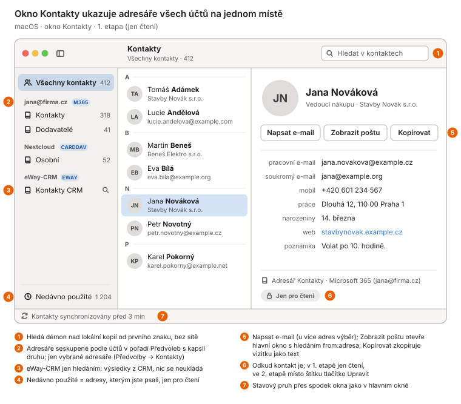
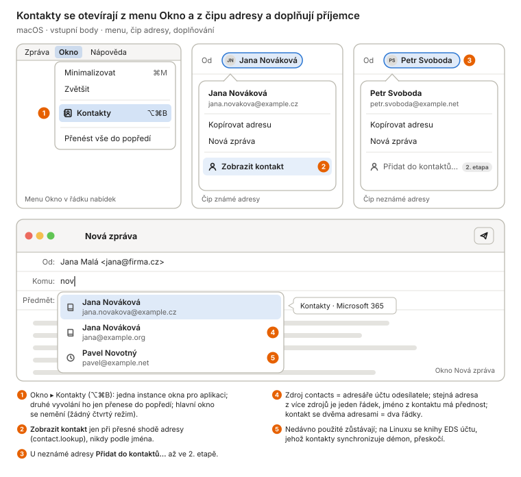
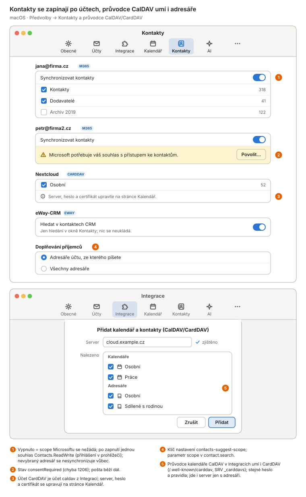
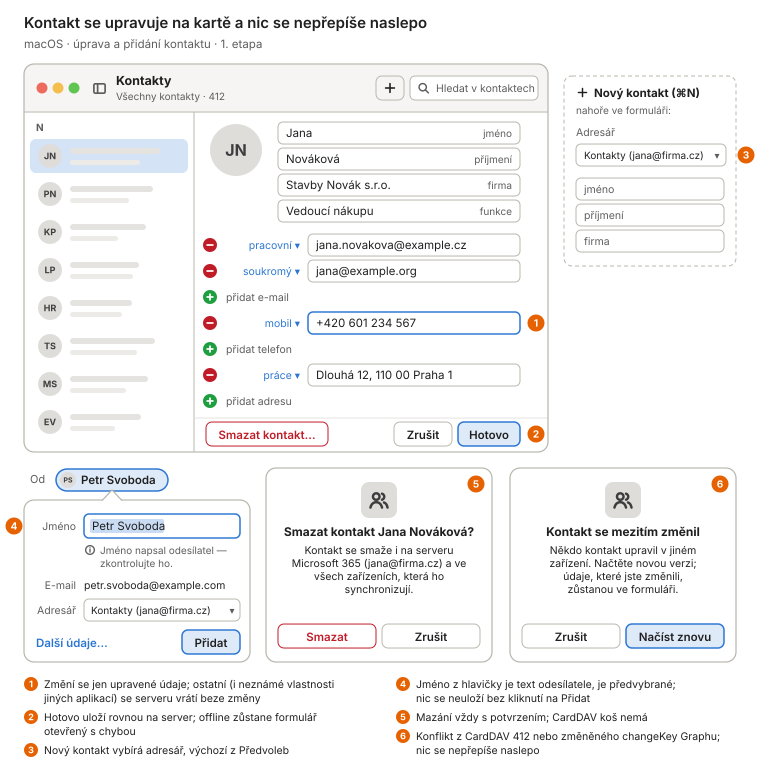
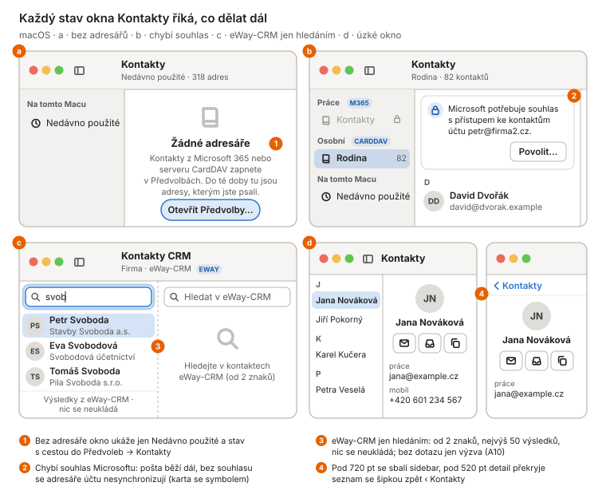
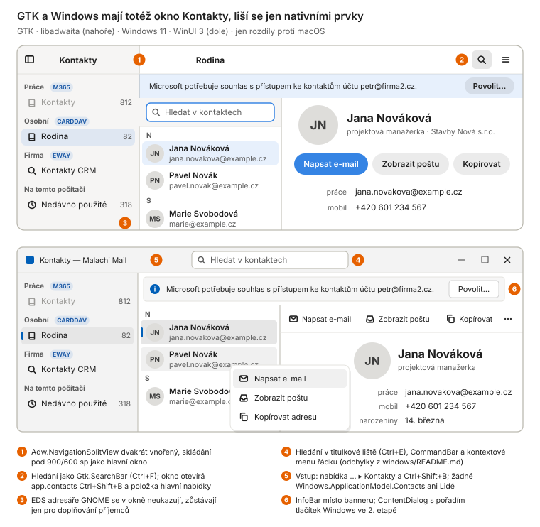
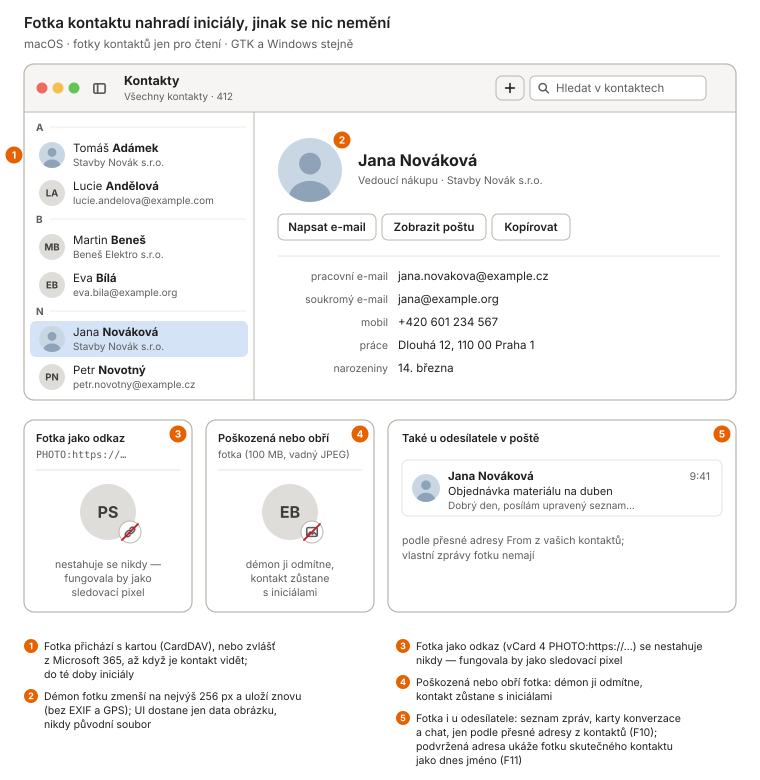

# Adresáře (kontakty z připojených služeb) — návrh ke schválení

Stav: schváleno vlastníkem 2026-10-30 (odpovědi v §8), větev
`claude/keen-bohr-rrjhm3`; implementace začíná. Wireframy jsou v [`address-book/`](address-book/) (W1–W6),
macOS je primární platforma a kreslí se celý, GTK a Windows jen tam,
kde se liší.

Navazuje na studii [`contacts-feasibility.md`](contacts-feasibility.md)
(30. 9. 2026). Ta vznikla před kalendářem a eWay-CRM a počítala se vším
od nuly (vlastní fronta změn, slučování po vlastnostech, nové okno,
nový průvodce). Od té doby démon dostal většinu potřebné instalace,
takže tento návrh je **o poznání menší**: kontakty kopírují vzor
kalendáře (cache serveru, zápis rovnou na server, souhlas na vyžádání,
stránka v Předvolbách po účtech) a CardDAV přidávají ke stávajícímu
klientovi CalDAV. Co studie navrhla a tady platí dál, se neopakuje,
jen odkazuje.

## 1. Co se mění (jednou větou)

Malachi Mail dostane **okno Kontakty**, které ukazuje adresáře
připojených služeb (Microsoft 365 / Outlook.com, CardDAV — Nextcloud,
iCloud, Seznam, Fastmail…) a nedávno použité adresy; tytéž kontakty
doplňují příjemce v okně Nová zpráva a u adresy v hlavičce zprávy je
*Zobrazit kontakt* nebo *Přidat do kontaktů…*. Už v 1. etapě se
kontakty dají vytvářet, upravovat a mazat, a to přímo na serveru
služby. eWay-CRM přijde ve 2. etapě.

**Žádný přesah do systému** (zadání vlastníka): aplikace na macOS
nečte ani nepíše Kontakty macOS (`CNContactStore`, žádný souhlas TCC),
na Windows nesahá na `Windows.ApplicationModel.Contacts` ani aplikaci
Lidé. Na Linuxu zůstává čtení EDS jen tak, jak je dnes (doplňování
příjemců), a do okna Kontakty se nedostane. Kontakty macOS i telefon se
s Malachi potkají jen přes server, protože synchronizují tentýž adresář.

## 2. Co už máme (průzkum kódu 2026-10-30)

| Potřeba | Existuje | Kde |
|---|---|---|
| WebDAV klient s limity, pinem, `sync-collection`, `PUT`/`DELETE` s `If-Match`, discovery (well-known, SRV) | ano, jen pro kalendář | `internal/caldav` (`Client`, `Propfind`, `SyncCollection`, `ListETags`, `Put`, `Delete`, `Discoverer`), testovací server `caldavtest` |
| Pravidla přihlašovacích údajů DAV (stejný origin, https na téže doméně), pin jen pro hosta serveru | ano | `core/accounts_caldav.go` (`calDAVOrigin`, `calDAVTransport`, `pinFor`) |
| Synchronizace cache serveru po účtech s backoffem, verze dat poskytovatele | ano, pro kalendář | `internal/calsync` (`Provider`, `Sink`, `SyncState`, `Versioned`, `Supervisor`) |
| Graph vedle pošty se sdíleným limiterem | ano | `graphWithCalendar`, `graph.NewLimiter(4)` |
| Souhlas Microsoftu na vyžádání, udělený scope v klíčence, stav `consentRequired` | ano | `oauth2flow/scope.go` (`calendarScopes`, `KeyGrantedScope`), `Backend.CalendarConsent`, chyba 1204 |
| Účet jen pro DAV v Integracích, průvodce s autodetekcí | ano | `kind: caldav`, `account.discoverCalDAV`, průvodce CalDAV ve všech třech klientech |
| Hledání kontaktů v eWay-CRM | ano, jméno + e-mail + firma | `internal/eway/query.go` (`SearchByName`, `ContactsByEmail`) |
| Doplňování příjemců se zdroji | ano | `contact.search` (§4.11), `compose/suggest.go` a porty |
| Menu čipu adresy | ano | GTK `window/addresses.go`, macOS `AddressChipView.showMenu`, Windows `MessageChips.FillAddressMenu` |
| Stránka Předvoleb po účtech s přepínačem synchronizace a výběrem | ano, Kalendář | `calendarctl.CalendarAccountController` a porty |

Nic z UI kontaktů zatím neexistuje; `contact.search` čte jen
`collected_addresses` a na Linuxu EDS.

## 3. Rozhodnutí v návrhu (A1–A16)

| # | Rozhodnutí | Proč |
|---|---|---|
| A1 | **Zdroje v 1. etapě:** (a) Microsoft 365 / Outlook.com přes Graph jako volba poštovního účtu `kind: graph` (`contacts.sync`, výchozí vypnuto, stejně jako `calendar.sync`); (b) CardDAV na stávajícím účtu `kind: caldav`, který dostane druhou capability `contacts` (stejný server, heslo a pravidla originu; adresář jde přidat i k serveru bez kalendáře); (c) *Nedávno použité* (`collected_addresses`) jako virtuální adresář jen pro čtení. | Pokrývá všechny služby, které aplikace umí připojit, a každý zdroj stojí na kódu, který už je. |
| A2 | **2. etapa:** eWay-CRM (A10). **Později (3. etapa):** Google Contacts (CardDAV s tokenem GOA na Linuxu, jinde jen s vlastním klientem OAuth uživatele, vestavěný klient Google dál není), fotky, skupiny, import a export vCard, přesun mezi adresáři. **Mimo rozsah:** Jira (uživatelé nejsou kontakty), adresář organizace (GAL), systémové adresáře (§1). | Studie §„Proč Google až ve 3. etapě“ platí beze změny. |
| A3 | **Samostatné okno Kontakty**, jedna instance pro aplikaci, ne čtvrtý režim hlavního okna. | Třísegmentový přepínač režimu (134 pt) už na macOS vyplňuje sekci sidebaru (240 pt, minimum 200); čtvrtý segment se nevejde a stál by 15–20 míst na klienta (lišta stavu, panel asistenta, toasty, `board.Allows`). Okno odpovídá Thunderbirdu i Mail + Kontakty na macOS. |
| A4 | **Démon drží cache serveru** jako u kalendáře: server je autorita, vypnutí synchronizace, změna serveru či uživatele a odebrání účtu cache smaže; autoritativní jsou jen volby uživatele (které adresáře). Synchronizace při startu účtu, každých 15 minut, při otevření okna Kontakty a hned po vlastním zápisu. | Stejný model jako `cal_*`; žádná nová třída dat k zálohování. |
| A5 | **Zápis rovnou na server (už v 1. etapě), bez fronty offline:** `contact.create/update/delete` volá server a teprve po úspěchu změní cache; offline = chyba a formulář zůstane otevřený s textem. Konflikt (CardDAV `412` na `If-Match`, u Graphu změněný `changeKey`) = chyba `contactConflict` s verzí serveru; UI nabídne *Načíst znovu* (úprava se ukáže nad novou verzí, pole, která uživatel změnil, zůstanou jeho). | Totéž jako zápisy kalendáře (server-first, D-rozhodnutí kalendáře). Odpadá operační log, slučování po vlastnostech a „kopie (konflikt)“ ze studie — největší a nejrizikovější kus její 2. etapy. Kontakty se upravují zřídka a vždy s uživatelem u okna. |
| A6 | **Úprava je záplata:** démon změní jen upravené vlastnosti; ostatní řádky vCard (skupiny `item1.`, `X-…`, fotka, neznámé vlastnosti) vrátí serveru bajt po bajtu, u Graphu `PATCH` jen změněných polí. Nová karta ve verzi, kterou adresář používá (iCloud 3.0). | Hlavní riziko ztráty dat jiných aplikací (studie, Rizika). |
| A7 | **Vlastní parser vCard** `internal/vcard` (3.0, 4.0, čte 2.1) s limity a korpusem `backend/testdata/vcard`, fuzz round-tripu, ne `go-vcard`. | Stejná volba jako `internal/caldav` a parser iCalendar (vlastní kvůli limitům a chybám); `go-vcard` je mladý a 4 → 3 neumí. |
| A8 | **CardDAV jako rozšíření `internal/caldav`**, ne nový balíček: `addressbook-home-set`, namespace `urn:ietf:params:xml:ns:carddav`, `addressbook-multiget`, `/.well-known/carddav` a SRV `_carddavs._tcp`, token `addressbook` v hlavičce `DAV`. Průvodce *Kalendář CalDAV* v Integracích se přejmenuje na **Kalendář a kontakty (CalDAV/CardDAV)** a po zjištění nabídne obojí. iCloud a Fastmail mají CardDAV na jiném hostu té domény, `calDAVOrigin` je už pouští. | Jedna implementace protokolu, jeden průvodce, jedno heslo. |
| A9 | **Synchronizační engine `internal/contactsync`** zrcadlí `calsync` (vlastní malé rozhraní `Provider{AddressBooks, Sync(book, sink)}` + `Create/Update/Delete`), ne sdílené rozhraní. | `calsync.Provider` je typovaný na kalendář (okna, výskyty, odpovědi); zrcadlo je menší než abstrakce. |
| A10 | **eWay-CRM ve 2. etapě, jen hledáním:** adresář eWay v okně Kontakty nevypisuje celý obsah CRM, ukáže pole hledání a výsledky z `SearchByName` (od 2 znaků, nejvýš 50, s časovým limitem); do doplňování příjemců jde, až když se ukáže, že API umí změny od data (pak synchronizace jako ostatní). | eWay nemá syncer (eway.md D21) a CRM bývá velké; hledání je hotové a nic neukládá. |
| A11 | **Doplňování příjemců** (`contact.search`): nový zdroj `"source": "contacts"` s názvem adresáře; výchozí rozsah = adresáře účtu odesílatele + Nedávno použité (jako dnes EDS), volitelně všechny adresáře (předvolba). Na GTK se knihy EDS účtu, jehož kontakty synchronizuje démon, přeskočí. | Studie W6; žádné dvojité řádky. |
| A12 | **Zobrazit kontakt** v menu čipu adresy (přesná shoda adresy, nikdy jména); u neznámé adresy *Přidat do kontaktů…* s předvyplněným, vybraným jménem (jméno z `From` je text útočníka). Nic se neuloží samo. | Studie W5, bezpečnost. |
| A13 | **Detail kontaktu je jen text:** jméno, firma a funkce, e-maily, telefony, adresy, narozeniny, weby, poznámka; všechno přes `stringValue` / `SetUseMarkup(false)` / `TextBlock.Text`, weby jen `http(s)` přes „Otevřít tento odkaz?“, telefon jen ke zkopírování. Avatar = iniciály jako jinde v aplikaci, fotky až ve 3. etapě a nikdy z URL. | Pravidlo 3; vCard je nepřátelský vstup. |
| A14 | **Akce v detailu:** *Napsat e-mail* (u více adres výběr), *Zobrazit poštu* (hlavní okno, režim Pošta, hledání `from:adresa` ve všech účtech — `search.query` beze změny), *Kopírovat* (vizitka jako text). | Užitek kontaktů v poštovním klientu je hlavně cesta k poště. |
| A15 | **Souhlas Microsoftu:** scope `Contacts.ReadWrite` (zápis je v 1. etapě), jen při zapnutí kontaktů u účtu (jako `calendar: true` v `account.oauthStart`); vlastník ho jednou přidá do registrace v Entra. GOA: nový příznak `ContactsDisabled` respektovaný jako `CalendarDisabled`. | Dvojí souhlas (Read, pak ReadWrite) by uživatele i správce organizace obtěžoval dvakrát. |
| A16 | **MCP most:** `search_contacts`, `get_contact` jen čtení (ohrada s nonce, `clean()`), `create_contact`/`update_contact` za `--allow-modify`; mazání přes MCP ne. | Studie, MCP most. |

## 4. Démon (`backend/`)

### 4.1 Úložiště — migrace `0023_contacts.sql`

Jen nové tabulky, nic na existujících (jako 0020 kalendáře):
`ab_books` (účet, href nebo id Graphu, název, `readOnly`, sync token /
ctag / delta link, `visible` = volba uživatele), `ab_contacts` (kniha,
href/id, ETag nebo `changeKey`, surová karta nebo JSON Graphu, odvozené
`display_name`, `sort_key`, `org`), `ab_emails` (normalizovaná adresa →
kontakt; index pro doplňování a `contact.lookup`) a contentless FTS5
`ab_contacts_fts` (jména, firma, adresy) se stejným tokenizérem jako
`messages_fts`. Na tyto tabulky se nikdy nepíše `INSERT OR REPLACE`.

### 4.2 Balíčky

| Balíček | Obsah |
|---|---|
| `internal/vcard` | parser a serializér, model `Card` (jméno, firma, e-maily, telefony, adresy, narozeniny, weby, poznámka), `Patch(raw, before, after)` měnící jen dotčené vlastnosti; limity (karta 1 MiB, 500 vlastností), korpus a fuzz (A6, A7) |
| `internal/caldav` (+) | CardDAV: home set, `ListAddressBooks`, `addressbook-multiget`, discovery `carddav`, `caldavtest` dostane adresáře a profily serverů (A8) |
| `internal/graph` (+ `contacts.go`) | `/me/contactFolders`, delta kontaktů po složkách, `GET`/`POST`/`PATCH`/`DELETE` `/me/contacts`, immutable ID |
| `internal/contactsync` | engine po účtech (A9): `Provider`, `Sink`, `Supervisor`, verze dat poskytovatele |
| `internal/core` (+) | `contacts_service.go` (metody API), `contact.search` se zdrojem `contacts`, poskytovatelé `graphContactsProvider`, `cardDAVProvider`, eWay hledání, rozšíření `accounts_caldav.go` o capability `contacts`, `notify.contactsChanged` s koalescencí 250 ms |
| `cmd/malachi-mcp` (+ `tools_contacts.go`) | nástroje z A16 za stejnou bránou jako kalendář (ne pod `--reply-only` a `--triage-run`) |

### 4.3 API (kompatibilní rozšíření protokolu 2, `docs/api.md` nový §4.19)

```jsonc
AddressBook    { "id", "accountId", "name", "kind": "graph"|"carddav"|"eway"|"recent",
                 "readOnly", "searchOnly", "visible", "count", "lastSyncAt" (opt) }
ContactSummary { "id", "bookId", "displayName", "sortKey", "org" (opt), "email" (opt) }
ContactCard    { "id", "bookId", "readOnly", "revision",
                 "name": { "given", "family", "middle", "prefix", "suffix" },
                 "displayName", "nickname", "org", "title",
                 "emails":    [{ "label", "address" }],
                 "phones":    [{ "label", "number" }],
                 "addresses": [{ "label", "street", "city", "region", "postcode", "country" }],
                 "urls": [{ "label", "url" }], "birthday": { "year" (opt), "month", "day" },
                 "note" }

addressBook.list   { accountId (opt) }                         → { books }
addressBook.set    { bookId, visible }
contact.list       { bookId | "all", query (opt), offset, limit } → { contacts, total }
contact.get        { contactId }                               → ContactCard
contact.lookup     { addresses: [..] }                         → { known: { address: contactId } }
contact.search     + "source": "contacts", + "book"; param "scope": "account"|"all"
contact.create     { bookId, card }                            → { contactId, revision }
contact.update     { contactId, revision, card }               → { revision }
contact.delete     { contactId, revision }

notify.contactsChanged { accountId, bookIds }

1110 contactNotFound · 1111 addressBookNotFound
1206 contactsConsentRequired   (data = { accountId, signIn }, jako 1204)
1308 contactConflict           (data = { server: ContactCard })
1509 addressBookReadOnly
```

`account.oauthStart` dostane `contacts: true` (jako `calendar`),
`GraphConfig` blok `contacts { sync }`, `CalDAVConfig` pole
`addressBookHomeSetURL` a `contacts: bool`; `account.discoverCalDAV`
vrací i nalezené adresáře. Všechno se jen přidává, `ProtocolVersion`
zůstává 2.

### 4.4 Rozhodnutí v `docs/architecture.md` §7

Nový záznam „Contacts from connected services: **decided**“ nahradí
zamítnutí z 6. 9. 2026 (vlastní CardDAV a Graph): důvody tehdy byly
duplicita s EDS (platí jen pro GNOME a řeší ji A11), chybějící token bez
GOA (od 25. 9. vlastní přihlášení démona) a absence CardDAV u Microsoftu
(řeší Graph). `docs/security.md` dostane odstavec o kontaktech (cache,
fotky z URL nikdy, mazání jen výslovné, logy jen počty a id).

## 5. Klienti

Pořadí podle pokynu vlastníka (macOS primární): čistá logika v Go jako
reference → **macOS** (brána vlastníka) → GTK a Windows, všechny v jedné
práci (pravidlo 6). Texty jen v Go referenci (`ui/internal/contacts`,
do `po/POTFILES`), macOS a Windows je berou s klíčem = msgid.

| Vrstva | Go reference / GTK | macOS | Windows |
|---|---|---|---|
| Čistá logika | `ui/internal/contacts` (sekce podle písmen ze `sortKey`, řádky detailu a jejich popisky, akce, texty, pravidla dostupnosti, validace formuláře), `ui/internal/contactsctl` (kontroler okna a předvoleb nad `board.Caller`) | `MalachiCore/Contacts`, `Controllers/Contacts*` | `Malachi.Core/Contacts` (jmenný prostor `Contacts`, třída `ContactsText`) a `Controllers/Contacts*` |
| Okno | `contacts_window.blp`, `Adw.NavigationSplitView` dvakrát vnořený, `Gtk.ListView` se sekcemi | `ContactsWindowController`, `NSSplitViewController` 3 sloupce, unified toolbar s hledáním | `ContactsWindow` (WinUI), hledání v titulkové liště, `CommandBar` nad detailem |
| Vstup (bez zkratky) | `app.contacts`, položka hlavní nabídky | menu Okno ▸ Kontakty | nabídka `…` ▸ Kontakty |
| Čip adresy | `addresses.go` `addr.contact` | `AddressChipView.showMenu` `onContact` | `MessageChips.FillAddressMenu` |
| Doplňování | `compose/suggest.go` ikona a tooltip zdroje | `Suggest.swift` | `Suggest.cs`, `SuggestionRow` |
| Předvolby | nová stránka Kontakty za Kalendářem (`preferences_contacts.go`) | `ContactsPaneViewController` za Kalendářem | `ContactsPreferencesPage` za Kalendářem |

## 6. Wireframy

Čísla v oranžových kolečkách odkazují na poznámky pod obrázkem (legenda je součástí každého SVG). Texty
jsou česky tak, jak by je ukázal `cs.po`; msgid budou anglické. Jména,
adresy a čísla jsou smyšlené.

### W1 macOS — okno Kontakty (1. etapa)



### W2 macOS — vstupní body (menu, čip adresy, doplňování)



### W3 macOS — Předvolby → Kontakty a průvodce CalDAV/CardDAV



### W4 macOS — úprava, přidání z čipu, mazání a konflikt



### W5 macOS — stavy (prázdno, souhlas, eWay ve 2. etapě, úzké okno)



### W6 GTK a Windows — v čem se liší



## 7. Plán prací a brány

Každý úkol dělá subagent, orchestrátor hlídá rozhraní a brány. Commity
po úkolech, conventional commits, push na pracovní větev.

| Úkol | Obsah | Ověření |
|---|---|---|
| **K0** příprava | `internal/vcard` (parser, serializér, `Patch`) s korpusem (Apple, Google, Nextcloud, Fastmail, export Outlooku, patologické karty) a fuzz round-tripu; ověřit Graph `If-Match` u `PATCH` kontaktu a `ContactsDisabled` v GOA | Go testy, fuzz |
| **K1** démon | migrace 0023, CardDAV v `caldav` + `caldavtest`, Graph kontakty, `contactsync`, všechny metody §4.3 včetně zápisu a `contactConflict`, `contact.search`, `docs/api.md` §4.19 (`TestDocsCoverAllMethods`), `architecture.md` §7, `security.md`, MCP (čtení i zápis za `--allow-modify`) | `go vet`, `go test ./...`, nezávislá revize |
| **K2** Go reference | `ui/internal/contacts` (seznam, detail, formulář a validace, texty), `contactsctl` (okno, úprava, přidání z čipu, předvolby), msgid v `po/POTFILES`, testy | `go test` čistých balíčků |
| **K3** macOS | port K2 + okno (W1, W4, W5), menu Okno, čip (W2), doplňování, Předvolby a průvodce (W3); vývojové kroky `MALACHI_START=contacts`, `contacts:edit`, `prefs-contacts` | `swift build`, `swift test`, `check-strings.py`, měření debug binárkou; **brána B1 vlastníka** nad kopií dat |
| **K4** GTK | totéž v GTK (W6); `MALACHI_GTK_START=contacts` | linuxový agent vlastníka: `gtk.sh make build`, `test-ui`, smoke, `make po`, `make lint`; **brána B2** |
| **K5** Windows | port macOS; exclusions bez řádků „contacts“ | **dělá Windows agent vlastníka** přes remote control (zadání a předávka odsud), včetně sestavení, testů, lintu a smoke; **brána B3** |
| **K6** překlady | `make po` lokálně, kontrola `cs.po` a obrazovek ve všech třech klientech s vlastníkem | „na lokálních instalacích ověříme překlady“ |
| **E2** 2. etapa | eWay-CRM jen hledáním (A10), totéž pořadí klientů | samostatné brány |

Odhad 1. etapy (čtení i zápis): zhruba 13–18 tisíc řádků včetně testů
(studie počítala 17–24 tisíc; ubyl nový protokolový klient, fronta
offline se slučováním, okno průvodce a stránka kopírují kalendář).

## 8. Odpovědi vlastníka (2026-10-30)

1. **Samostatné okno** Kontakty, ne čtvrtý režim (A3).
2. **eWay-CRM až ve 2. etapě** (A10).
3. **1. etapa rovnou čtení i úpravy.**
4. **Zápis jen online**, jako kalendář (A5).
5. **Bez klávesové zkratky**, jen položky menu.
6. **`Contacts.ReadWrite`** hned (A15); vlastník ho přidá do registrace
   v Entra.
7. Wireframy schválené, začít implementaci. Windows část dělá Windows
   agent vlastníka (remote control), GTK sestavení a testy linuxový agent
   vlastníka.

## 9. Fotky kontaktů jen pro čtení (schváleno 2026-10-31)

Vlastník (2026-10-31): fotka kontaktu se má ukázat místo avataru
s iniciálami, zatím jen čtení. Wireframe:
[`address-book/w7-photos.svg`](address-book/w7-photos.svg).



### 9.1 Rozhodnutí (F1–F10)

| # | Rozhodnutí | Proč |
|---|---|---|
| F1 | **Jen čtení:** fotka se ukáže v seznamu a v detailu okna Kontakty místo iniciál. Nastavení, změna ani smazání fotky ne; úprava kontaktu fotku zachová beze změny (záplata vCard i `PATCH` Graphu na ni nesahají už dnes). | Zadání vlastníka; zápis fotky je jiná práce (Graph u osobních účtů fotku zapsat nedovolí). |
| F2 | **CardDAV:** fotka je vložená v kartě (`PHOTO;ENCODING=b` ve 3.0, `PHOTO:data:image/…;base64,` ve 4.0, Apple `X-ABShowAs` se ignoruje). Přijde se synchronizací, žádný požadavek navíc. `vcard` dnes nedekóduje řádky nad 256 KiB (`MaxLineBytes`); pro `PHOTO` se hranice zvedne na limit karty 1 MiB, ostatní vlastnosti zůstanou na 256 KiB. | Fotka je pro většinu serverů součást karty. |
| F3 | **Microsoft 365:** `GET /me/contacts/{id}/photo/$value` (u složek `/me/contactFolders/{f}/contacts/{id}/photo/$value`), **líně**: až když kontakt klient ukazuje, jednou na verzi kontaktu (`changeKey`); 404 = bez fotky a zapamatuje se. Sdílený limiter účtu, nejvýš 4 souběžně, strop 4 MiB na odpověď. | Delta fotku nenese; stahovat stovky fotek při každé synchronizaci by plýtvalo limitem Graphu. |
| F4 | **`PHOTO` jako odkaz** (`PHOTO;VALUE=uri:https://…`, `PHOTO:https://…`) se **nikdy nestáhne**, kontakt má iniciály. | Odkaz ve sdíleném adresáři by fungoval jako sledovací pixel (studie, Bezpečnost). |
| F5 | **Démon fotku zpracuje:** `image.DecodeConfig` před dekódováním (JPEG, PNG, GIF; nejvýš 40 Mpx a 4 MiB vstupu, jinak odmítnout), dekódování, zmenšení na nejvýš 256 × 256 px, oříznutí na čtverec ze středu a nové kódování do JPEG (kvalita 85; s průhledností PNG). Původní bajty nikdy neopustí démon; nové kódování zahodí EXIF, GPS i barevné profily. Selhání = kontakt bez fotky, do logu jen třída chyby a id. | Obrázek ze serveru je nepřátelský vstup (pravidlo 3); ochrana proti dekompresní bombě; malé jednotné obrázky jsou levné pro cache i UI. |
| F6 | **Zmenšování:** `golang.org/x/image/draw` (BSD-3, projekt Go jako `x/net` a `x/text`, které jádro už má) s `CatmullRom`; zdůvodnění v commitu. Alternativa bez závislosti: vlastní průměrování ploch (asi 80 řádků, horší kvalita). | Kvalita a ověřený kód; licence vyhovuje (CLAUDE.md, nic silnějšího než MPL/LGPL). |
| F7 | **Úložiště:** migrace `0024_contact_photos.sql` (0023 už proběhla nad kopiemi vlastníka a needituje se): tabulka `ab_photos` (`contact_id` PK s CASCADE z `ab_contacts`, `revision` = ETag/changeKey, ze které je, `state` `ok`/`none`/`refused`, `mime`, `data` BLOB ≤ 64 KiB). Vlastní tabulka, aby `contact.list` nečetl BLOBy. Cache serveru jako zbytek kontaktů (smaže se s adresářem a účtem). | Odděleně od řádků seznamu; stav `none` zabrání opakovaným dotazům Graphu. |
| F8 | **API (kompatibilní rozšíření protokolu 2, `docs/api.md` §4.19):** `ContactSummary.photo` a `ContactCard.photo` = `"ready"` \| `"remote"` (u Graphu ještě nestažená), bez pole = bez fotky; nová metoda `contact.photo { contactId }` → `{ "state": "ready" \| "none", "mime", "data" (base64), "revision" }`, chyba 1110 pro neznámý kontakt; u `remote` ji démon stáhne (časový limit 15 s), uloží a pošle `notify.contactsChanged` s tím adresářem. `contact.lookup` dostane volitelné `withPhotos: true` → navíc `photos: { address: { "contactId", "state" } }` jen pro adresy, jejichž kontakt fotku má nebo může mít (víc kontaktů s toutéž adresou: první viditelný podle `sort_key`). Nová chyba ne: odmítnutá fotka je `none`. | Klient vidí, kde fotku žádat, a nečeká na Graph u kontaktů bez fotky; odesílatel v poště se páruje jedním dotazem na adresy zobrazených zpráv. |
| F9 | **Klienti — okno Kontakty:** jedna komponenta avataru (fotka, jinak iniciály) v seznamu a detailu; fotky jen pro viditelné řádky (blízké okno jako těla v chatu), cache v paměti nejvýš 200 obrázků, nová fotka po `contactsChanged` s jinou `revision`. Kruhový ořez kreslí UI; přístupné jméno zůstává u řádku. GTK `Gdk.Texture` z bajtů v `Gtk.Picture`/`Adw.Avatar` (`custom-image`), macOS `NSImage(data:)`, Windows `BitmapImage.SetSourceAsync` z `InMemoryRandomAccessStream`. | Stejné místo jako dnešní iniciály, nic dalšího v rozložení. |
| F10 | **Klienti — odesílatel v poště (rozhodnutí vlastníka 2026-10-31):** fotka kontaktu nahradí avatar všude, kde ho aplikace už kreslí podle odesílatele: řádek seznamu zpráv (se zapnutým `show-avatars`), karta konverzace, bublina chatu Pošty i Nástěnky a hlavička zprávy, má-li avatar. Párování jen **přesnou adresou** `From` (bez ohledu na velikost písmen, nikdy podle jména) přes `contact.lookup { withPhotos }` jednou pro adresy zobrazených zpráv (dávky po 200, cache podle adresy, invalidace `contactsChanged`); vlastní zprávy fotku nedostávají (avatar „Vy“ zůstává). `monochrome-avatars` se na fotky nevztahuje. Bez fotky beze změny. | Užitek kontaktů v poštovním klientu; jeden dotaz na stránku seznamu, ne na řádek. |
| F11 | **Riziko podvržené adresy:** zfalšované `From` ukáže fotku skutečného kontaktu. Stejně jako dnes jméno a iniciály z hlavičky to není důkaz pravosti; fotka se proto ukazuje jen podle adresy z kontaktů uživatele (nikdy z pošty) a `docs/security.md` to uvede. Vazba na ověření DKIM se zatím nedělá (démon DKIM ověřuje jen pro hromadnou poštu). | Stejné chování jako Apple Mail či Outlook; vědomě přijaté riziko, zapsané. |
| F12 | **Mimo tento krok:** fotky v MCP mostu (most dál vrací jen text), zápis fotky, fotky z adresáře organizace. | |

### 9.2 Bezpečnost (`docs/security.md` §4.4 doplnit)

- Fotka je data obrázku od třetí strany: limity před dekódováním (F5),
  dekodéry standardní knihovny Go (bez cgo), nové kódování, do UI jen
  bajty z démona. Patologický korpus `backend/testdata/vcard/photos/`
  (40 000 × 40 000 px PNG o pár kilobajtech, zkrácený JPEG, GIF se
  stovkami snímků, nesmyslný MIME, base64 s mezerami a neplatnými znaky,
  `PHOTO` s `data:` a s `https:`) a fuzz `FuzzPhoto`.
- Žádné stažení podle URL z karty (F4); Graph jen přes stávající klient
  s tokenem na `graph.microsoft.com`.
- Logy jen počty, id a třídy chyb.

### 9.3 Úkoly a ověření

| Úkol | Obsah | Ověření |
|---|---|---|
| **P1** démon | `vcard` (`Card.Photo` = bajty a MIME z vloženého `PHOTO`, `PhotoURI` jen příznak, limit řádku pro `PHOTO`), `internal/contactphoto` (F5, F6, korpus, fuzz), Graph `ContactPhoto`, migrace 0024, store, synchronizace CardDAV uloží fotku, `contact.photo` a `photo` v souhrnech, `docs/api.md`, `security.md`, MCP beze změny (test, že fotku nevrací) | `go vet`, `go test ./...`, fuzz, revize |
| **P2** Go reference | `ui/internal/contacts` `Avatar` (fotka vs. iniciály, pravidla cache a blízkého okna), `contactsctl` `Photos` (dotazy podle id i podle adres odesílatelů, dávky, cache, invalidace), testy; žádný nový msgid | `go test` |
| **P3** macOS | port P2 + avatar v okně Kontakty (F9) a u odesílatele v poště (F10); vzorové fotky | napsané v cloudu; na Macu `swift build`, `swift test`, měření; **brána vlastníka** |
| **P4** GTK | totéž v GTK, vzorová data s fotkami, smoke | napsané v cloudu; na Linuxu build, test, smoke, `make po`, lint |
| **P5** Windows | totéž ve Windows klientu, smoke | napsané v cloudu; na Windows `build.ps1 app`/`test`/`lint`, smoke, průchod UIA |

Rozhodnutí vlastníka (2026-10-31): veškerý vývoj pro všechny tři
platformy v cloudu, na skutečných strojích jen ověření.

Odhad: démon 800–1 100 řádků včetně testů a korpusu, Go reference
200–300, každý klient 200–400; celkem asi 1,5–2,5 tisíce řádků.

### 9.4 Odpovědi vlastníka (2026-10-31)

1. Zmenšování přes `golang.org/x/image/draw` (F6).
2. Microsoft 365 líně, až když je kontakt vidět (F3).
3. Rozsah včetně odesílatele v poště (F10, F11).
4. Vývoj všech tří klientů v cloudu, na skutečných strojích jen ověření.

## 10. Historie

- 2026-10-30 první návrh (na základě studie z 30. 9. a průzkumu kódu po
  kalendáři a eWay-CRM).
- 2026-10-30 vlastník: odpovědi v §8, wireframy upravené (eWay ve
  2. etapě, úpravy v 1. etapě, bez zkratky), začíná implementace.
- 2026-10-31 návrh fotek kontaktů jen pro čtení (§9, W7), ke schválení.
- 2026-10-31 vlastník: odpovědi v §9.4 (x/image/draw, Graph líně, i odesílatel v poště, vývoj v cloudu).
